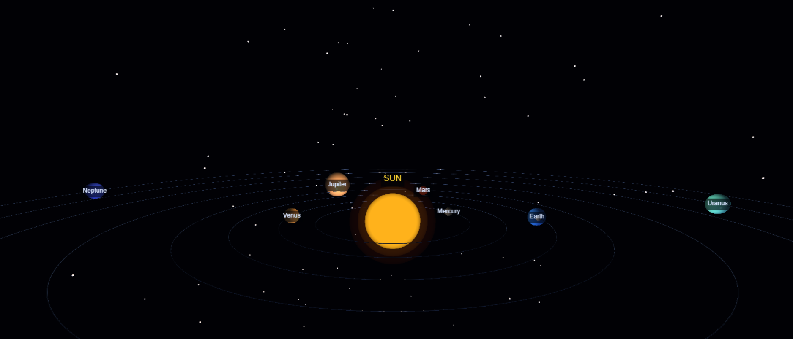

# 🌌 3D Interactive Solar System Simulation

An interactive 3D Solar System simulation developed using **Python and VPython**. This project visualizes the Sun, eight planets, their orbital paths, Saturn's rings, and Earth's Moon through a continuously running 3D animation.

The simulation allows users to explore the planetary system by rotating the 3D scene and zooming in and out.

## ✨ Features

- **Interactive 3D Environment:** Explore the solar system in a 3D space.
- **Sun Visualization:** A glowing Sun with an animated pulsing effect.
- **Eight Planets:** Mercury, Venus, Earth, Mars, Jupiter, Saturn, Uranus

